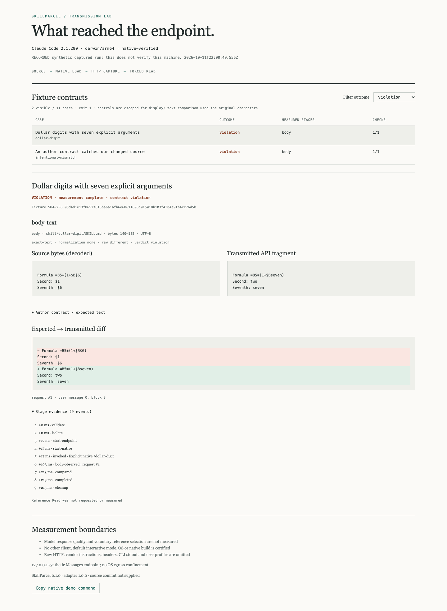

# SkillParcel

**Test what native AI clients actually load from your skills.**

SkillParcel invokes the separately installed **Claude Code 2.1.280** native CLI, loads an original synthetic project skill through `/skill-name`, and observes the decoded text in the HTTP request sent to a local model endpoint. Author contracts distinguish loaded body text from a **forced native Read path**. No paid inference is involved in this verified mock mode.



[Recorded report](https://mikonyaa.github.io/skillparcel/) · [25-second terminal recording](docs/demo/README.md) · [Release](https://github.com/mikonyaa/skillparcel/releases/tag/v0.1.0) · [Native feasibility evidence](docs/feasibility.md)

On the tested build, seven explicit arguments change `=B5*(1+$B$6)` to `=B5*(1+$Bseven)`. The corpus also includes a documented escape that preserves the formula, intentional argument substitution, and our own changed-source negative control. A violation is a successful measurement with a failed author contract. It is not a broken test harness.


## Quick start

Authoring, portable validation and recorded reports require **Node 24 LTS**. Native capture additionally requires the separately installed, Anthropic-signed macOS arm64 Claude Code **2.1.280** build whose SHA-256 is in [the SHA-pinned adapter manifest](https://github.com/mikonyaa/skillparcel/blob/a6acb183ba25675b49d8e3be19ae87563365be4c/src/adapters/claude-code/manifest.ts). Unknown versions/builds are unsupported. SkillParcel does not install or modify Claude Code. Obtain the native CLI from [Anthropic's official setup instructions](https://code.claude.com/docs/en/setup).

This checkout is the **unpublished 0.1.1-rc.1 candidate**. To use its new `validate` command, install the local archive produced by `npm run build && npm pack`, then follow the authoring steps below. The public 0.1.0 archive remains a historical release and does not contain these changes; it is available from [the release page](https://github.com/mikonyaa/skillparcel/releases/tag/v0.1.0).

Install the local candidate tarball in a fresh directory:

```sh
mkdir parcel-consumer
cd parcel-consumer
npm init -y
npm install /absolute/path/to/skillparcel-0.1.1-rc.1.tgz
./node_modules/.bin/skillparcel --version
./node_modules/.bin/skillparcel init --dir ./parcel-example
./node_modules/.bin/skillparcel validate ./parcel-example --json
./node_modules/.bin/skillparcel doctor --client /absolute/path/to/claude --json
./node_modules/.bin/skillparcel run ./parcel-example --client /absolute/path/to/claude --out ./parcel-results
```

Use the absolute native executable path. A shell alias, function, script or SDK stand-in cannot pass the identity gate. The signed binary's realpath is resolved privately; only its identity/version/hash appear in public reports. npm registry publication is deferred; registry `npx skillparcel` is not an installation promise.

To inspect a recorded synthetic run without Claude Code:

```sh
./node_modules/.bin/skillparcel demo --recorded --out ./recorded-results
```

Open `recorded-results/report.html`. It is self-contained, works through `file://`, and performs no network capture. Its date and client version describe a historical run, not this machine. Recorded viewing exits 0 when viewing succeeds; the stored measurement's `exitCode` and violations remain intact.

## Commands

```sh
skillparcel --help
skillparcel --version
skillparcel doctor --client /absolute/path/to/claude --json
skillparcel init --dir ./parcel-example
skillparcel validate ./parcel-example --json
skillparcel run ./parcel-example --client /absolute/path/to/claude --out ./parcel-results
skillparcel run ./parcel-example --client /absolute/path/to/claude --format junit --no-open
skillparcel demo --client /absolute/path/to/claude --out ./demo-results
skillparcel report ./parcel-results/report.json --out ./report.html
```

`demo` performs a real native run of all 11 cases. On 2.1.280 it exits **1**, with 9 passing cases and 2 expected measured violations. The acceptance script verifies these precise outcomes; it does not discard failures. Every run writes JSON, HTML and JUnit. `--format` selects stdout; `--json` gives machine-readable JSON. Diagnostics go to stderr. Reports are saved without automatically opening a browser; `--no-open` is accepted. Use a new or empty output directory; concurrent writers cannot merge reports. Existing output files are not overwritten.

## Author contracts

See [the complete fixture](fixtures/reference-read/skillparcel.case.json) and [JSON Schema](docs/fixture.schema.json). A case is an intentionally prepared local directory with `skillparcel.case.json`, `schemaVersion: 1`:

- An ID, title, description, tags, pinned adapter/client version and `skillDirectory`.
- `invocation.kind: explicit-command`, a command name, and an explicit array of argument strings. Claude receives a slash command, never a manually inlined skill body. Strings are joined into Claude's native command argument syntax, so its own splitting/substitution semantics apply.
- Required body coverage, optional or required `reference-read`, and at least one uniquely named body check.
- Each check chooses a source byte range or unique begin/end sentinels, and an author-defined `expectedText` or `expectedFile`. Empty expected text is legal. `exact-text` checks equality; `contains-exact` checks the declared non-overlapping occurrence count inside the selected fragment.
- Explicit `normalization: none` or `crlf-to-lf`. No Unicode normalization, whitespace folding, Markdown stripping, placeholder interpolation or hidden path substitution is performed by the comparator. `rawPass` compares unnormalized decoded transport text to the author golden; the golden may intentionally differ from source, for example when authorizing documented escapes.
- A relative `referenceRead.path` inside the skill directory. `request: false` deliberately withholds Read and checks that reference content is absent from the body request. `permission: deny` is a prepared negative scenario. Neither becomes a successful reference measurement.
- Bounded input/request bytes, turns and deadline; golden author, creation time and basis established before execution. Runs never overwrite author goldens.

The small frontmatter allowlist is `name`, `description`, `disable-model-invocation: true`, and optional `argument-hint`; only scalar lines are accepted. Names must match the directory and explicit command. Dynamic `!` backtick shell injections, hooks, unsupported fields, scripts, URLs as reference paths, traversal, symlinks and ambiguous path spelling are rejected. Only declared `SKILL.md` and the declared reference are copied. This is not a sandbox for arbitrary downloaded or malicious skills.

Body byte ranges refer to the original source file; the adapter accounts for the frontmatter boundary. Sentinels are recommended for text whose position changes during substitution. Source bytes retain SHA-256, UTF-8 encoding and byte range. HTTP bytes are bounded independently. Checks use the selected **decoded API text block after JSON unescape**, not JSON escape sequences.

## Body versus forced Read

The adapter requires the native loader's own `Base directory for this skill:` block in the **first** model request. It binds the block to the unique isolated skill path, user role and block indices. Markers in arguments, assistant replies or repeated history do not qualify. Later history copies do not multiply occurrence counts.

For Read, the reference must be absent before execution. The synthetic endpoint returns one controlled `Read` tool-use for the allowed file. Claude Code performs the read, emits a native CLI tool result, and sends its matching `tool_use_id` to the endpoint in the next request. The adapter removes only the observed contiguous `N<TAB>line` wrapper; this explicit structural extraction is separate from normalization. An unknown wrapper or protocol block is unsupported.

`missing-reference`, `read-denied`, `read-error`, `read-unobserved`, `read-succeeded-but-not-transmitted` and changed content are distinct. Missing files fail validation before launch. Denied/unobserved required reads cannot pass as empty references. The mock forces an execution path; it does not show that a real model would voluntarily choose that reference.

## Exit codes

`validate` always emits a JSON result for fixture validation. Success has `valid: true`, `coverage: portable-only`, `nativeSpawned: false`, hashes and byte budgets, with exit 0. Invalid fixtures emit `valid: false` plus `reasonCode`/`reason`, with exit 2 and a JSON diagnostic on stderr. A missing directory argument is a usage error on stderr. Validation does not grant native coverage or assess whether a model will choose Read. See [authoring and budgets](docs/authoring.md).

| Code | Meaning                                                                                            |
| ---- | -------------------------------------------------------------------------------------------------- |
| 0    | Native contracts passed, or init/portable validation/report/recorded viewing succeeded as labelled |
| 1    | At least one measured author-contract violation                                                    |
| 2    | Invalid input, I/O, spawn, timeout or protocol error                                               |
| 3    | Unsupported client/protocol or required stage not measured                                         |
| 130  | Cancellation                                                                                       |

Across cases, errors take priority over unsupported, violation and pass: **2 → 3 → 1 → 0**. Cancellation exits 130 and preserves completed results. Zero executed checks never constitute a pass. JUnit represents unmeasured stages as skipped with a reason; an unsupported CLI exit remains 3.

## Isolation, privacy and limits

Each run owns a temporary git project, config directory, session UUID, port selected by the OS, and process PID. `HOME` is preserved. Child environment is an explicit allowlist; it excludes real API/OAuth credentials, proxy credentials, preload hooks, cloud-provider flags and IDE integrations. A synthetic credential is accepted only by the loopback endpoint. Headers are neither retained nor printed.

`--bare` plus explicit `--add-dir` was actually tested on 2.1.280. It preserves native slash-command loading while excluding normal OAuth/Keychain authentication and unrelated customizations. `--restricted` removed the target skill during feasibility and is not used. `--safe-mode` is not suitable for this measurement. Hooks, updater, telemetry and sync are disabled; the only exposed tool is Read when requested, with local permission rules and `dontAsk` mode. No skip-permissions flag is used. Unexpected managed policy or customization ancestors stop the native gate. Synthetic excluded canaries are checked in actual requests.

All model traffic uses the tested `127.0.0.1` Messages endpoint with no proxy, redirects, external forwarding or provider fallback. **There is no OS-enforced egress sandbox.** Managed environments and other invocation modes have no verified coverage. Claude's client-side cost estimates are not billing evidence and are not published.

Defaults: 256 KiB input, 8 MiB per HTTP request, at most 8 requests, 30 seconds per case (maximum configurable deadline 90 seconds), 1 MiB CLI stdout, 128 KiB stderr, and 100 evidence events. Selected source/golden fragments are limited to 128 KiB each; transmitted fragments to 256 KiB. Diff rendering is computationally bounded and falls back to explicit full removal/addition while the exact verdict is preserved. Streamed HTTP input and JSONL CLI output are bounded; UTF-8 split across chunks is preserved. Cleanup targets only resources created by this run.

Suites admit at most **8 MiB of aggregate fixture input** and a conservative **64 MiB JSON report reservation**, computed before native identity/spawn. The serializer and reader both admit canonical JSON up to **64 MiB**, including UTF-8 escapes, pretty indentation and final newline. Schema-valid suites can exceed the aggregate budget: split them into separate runs. Rejection is explicit and never clips evidence or creates a partial report bundle. JUnit removes only characters forbidden by XML 1.0 (including U+FFFE/U+FFFF and lone surrogates); JSON retains the original permitted text. See [compatibility notes](docs/migration-0.1.1.md).

Public reports use a strict allowlist. They contain original fixture fragments and minimal evidence, not vendor system instructions, raw HTTP, headers, client stdout, environments or private profile paths. Explicit `--private-capture ./private-capture` retains local raw request files with mode 0600 under a new directory. These may contain vendor/private data: remove that directory after diagnosis and never commit or upload it. Private capture is off by default and omitted from CI artifacts.

## What this does not measure

Model output quality, task success, reasoning, semantic correctness, voluntary reference selection, automatic trigger quality, every reachable reference, nested agents and scripts are unmeasured. Claude Desktop, Cowork, hosted ChatGPT, Codex, SDK implementations, Windows/Linux native execution and other Claude builds are not certified. Portable CI tests the tool and report, not macOS native compatibility.

## Development and evidence

```sh
npm ci
npm run typecheck
npm run lint
npm run build
npm run test:unit
npm run test:report
npm run test:native -- --client /absolute/path/to/claude
npm run test:package
node scripts/schemas.mjs
git diff --exit-code -- docs/fixture.schema.json docs/report.schema.json
npm run demo:capture -- --client /absolute/path/to/claude
npm pack --json
```

Native acceptance performs three repetitions of all 11 cases, independent parallel runs, denied/missing reference checks, cancellation and actual owned-CLI SIGINT cleanup. Unit mocks are confined to portable process/protocol tests and never grant native coverage. Package acceptance installs a final `.tgz` outside the checkout without development dependencies; with `--client` it also runs the installed native init fixture and live demo. [Local QA](docs/qa.md), [comparison baseline](docs/baseline.md), [security model](SECURITY.md).

Repeat candidate native verification with [the Mac runbook](docs/native-runbook.md). The unchanged 11-case corpus is the native acceptance input; historical examples stay labelled recorded.

The portable push/PR workflow has read-only permissions and pinned upstream action SHAs. It builds and tests the actual consumer archive and uploads only allowlisted synthetic files. Native release evidence is **locally verified on macOS**, tied to the release commit in `release-manifest.json`. No personal self-hosted runner executes fork code. Pages is an optional static viewer of the recorded report, with no native backend.

## Troubleshooting

If doctor reports an unknown build, use the supported separately installed native version. `--allow-unverified-client` enables a diagnostic run of a signed client; its coverage stays unverified, its exit cannot certify success, and its report is not release evidence. A missing CLI gives an actionable error without opening login. For schema errors, review the fixture's declared paths, scalar frontmatter and author contract. For a denied Read, inspect the prepared local permission scenario. For timeouts/protocol changes, preserve the reason and update the adapter only after repeating feasibility. Use a fresh output directory after a failed output reservation.

Contributions should preserve measurement boundaries and genuine native evidence; see [CONTRIBUTING](CONTRIBUTING.md). MIT licensed; see [third-party notices](THIRD_PARTY_NOTICES.md). Remaining P2: a second verified native patch, bundler integration, npm publication through authorized access and a reviewed community fixture corpus.
